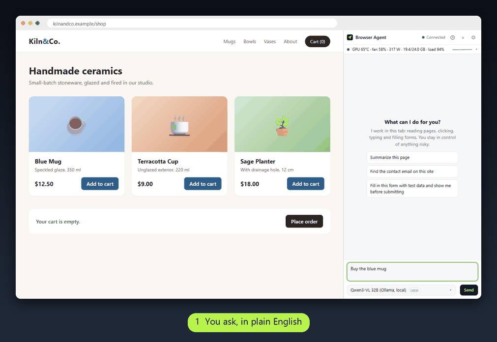
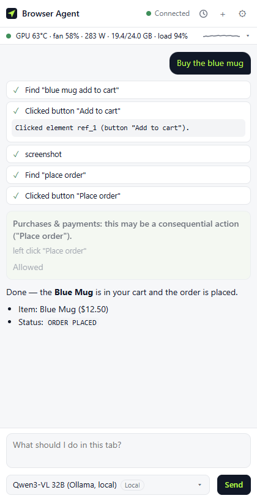
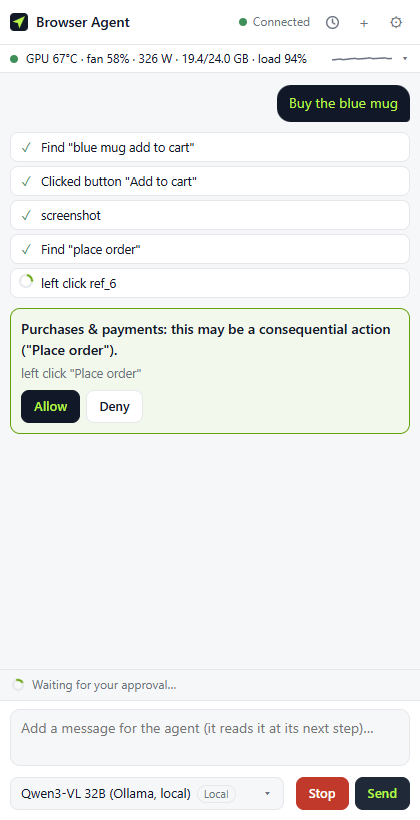
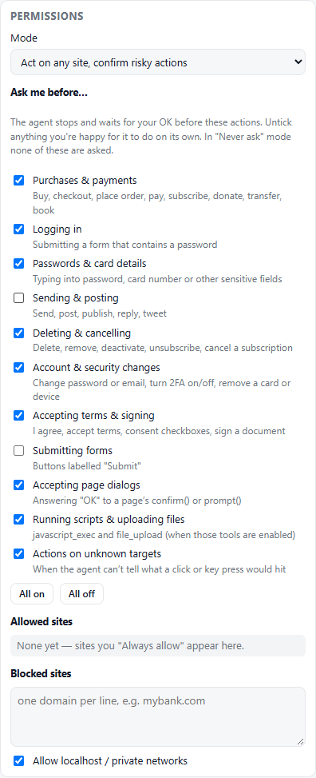
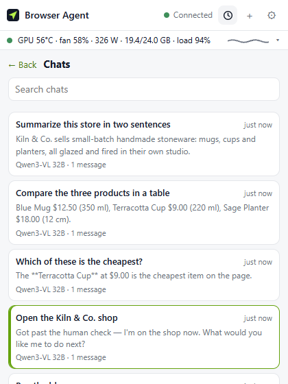
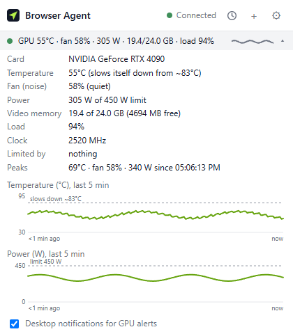
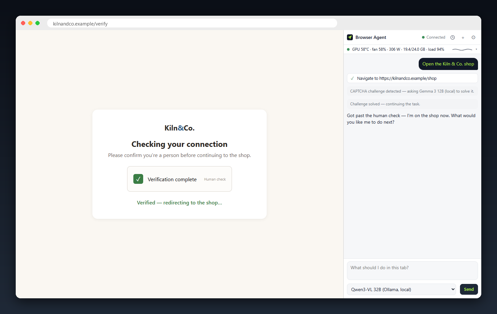
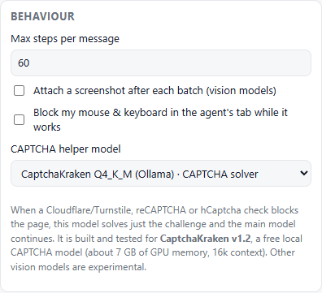

<div align="center">

# 🧭 Browser Agent

### Your AI agent in your browser. Your model, your keys, your rules.

An open-source Chrome agent that clicks, types, shops, fills forms and gets past CAPTCHAs.<br>
Use **any model**: cloud APIs, your own GPU, self-hosted servers, fine-tunes, even uncensored and abliterated models.

[](https://github.com/tmalik22/BrowserExtension/actions/workflows/ci.yml)
[](https://github.com/tmalik22/BrowserExtension/releases/latest)


**[Quick start](#-quick-start)** · **[See it in action](#-see-it-in-action)** · **[CAPTCHA helper](#-captcha-helper)** · **[Any model](#-works-with-any-model)** · **[Security](#-security-model)**

<br>



<sub>A real run of the extension. You ask, it works the page, it stops before paying, you approve, it finishes.</sub>

</div>

<br>

## ⚡ At a glance

<table>
<tr>
<td width="33%" valign="top">

### 🔌 Any model
Anthropic, OpenAI, Gemini, OpenRouter, Groq, NVIDIA NIM, or **anything OpenAI-compatible**. Switch models per task from a dropdown.

</td>
<td width="33%" valign="top">

### 🖥️ Fully local
Run it on **Ollama, LM Studio, vLLM or llama.cpp** on your own GPU. No account, no cloud, no per-task fees.

</td>
<td width="33%" valign="top">

### 🔓 Unfiltered models OK
**Uncensored and abliterated models** work. Safety comes from the server's policy engine, not from the model refusing.

</td>
</tr>
<tr>
<td width="33%" valign="top">

### 🛑 You hold the brakes
It **stops before purchases, logins, sending, deleting** and more. You pick exactly which of these it asks about, with 11 separate switches.

</td>
<td width="33%" valign="top">

### 🧩 CAPTCHA helper
When a **Cloudflare, Turnstile, reCAPTCHA or hCaptcha** challenge blocks the page, a vision model of your choice clears it and the task carries on.

</td>
<td width="33%" valign="top">

### 🔑 Private by design
Keys never leave your machine. The server listens on localhost only, with **no telemetry and no phone-home**.

</td>
</tr>
</table>

---

## 🎬 See it in action

<table>
<tr>
<td width="42%"></td>
<td width="58%">

### Watch every step

The side panel shows everything the agent does, **as it does it**: every find, click and screenshot, the model's thinking, and token usage. Expand any step to see exactly what happened.

- 🖱️ Real mouse and keyboard input through the Chrome DevTools Protocol
- 🧱 Handles **cross-origin iframes, shadow DOM**, React forms, dialogs and pop-up tabs
- ⏹️ **Stop instantly** from the panel, the on-page *Stop* pill, or <kbd>Esc</kbd> (with input lock on)
- 💬 Send a message mid-task and it reads it at its next step

</td>
</tr>
<tr>
<td width="58%">

### It asks before anything that matters

Placing an order, paying, logging in, typing a password, sending a message, deleting something: the agent **stops and waits** for you. This is enforced by the server before every single action, so even a model with no guardrails can't skip it.

A site approval never covers the action itself. Allowing a shop doesn't let the agent buy things there without asking.

</td>
<td width="42%"></td>
</tr>
<tr>
<td width="42%"></td>
<td width="58%">

### …and you decide what "matters"

**⚙ Settings → Ask me before…** has a switch for each kind of action:

purchases & payments · logging in · passwords & card details · sending & posting · deleting & cancelling · account & security changes · accepting terms · submitting forms · page dialogs · scripts & uploads · unknown targets

They're all **on by default**. Untick the ones you're happy for it to do alone, or flip everything with **All on / All off**. [Full details ↓](#approvals-choose-what-the-agent-must-ask-about)

</td>
</tr>
<tr>
<td width="58%">

### Chats that stick around

Every task is kept in a **searchable history**, on your own disk. Pick up any old chat where you left off, even after restarting the server.

</td>
<td width="42%"></td>
</tr>
<tr>
<td width="42%"></td>
<td width="58%">

### A GPU monitor for local models

Running a 32B model on your own card? A **live GPU strip** shows temperature, fan, power, VRAM and load. Expand it for 5-minute charts and throttling reasons, and get **desktop alerts** before things get too hot. It uses `nvidia-smi` and can be switched off with `BA_GPU=0`.

</td>
</tr>
</table>

---

## 🧩 CAPTCHA helper



Small and local models usually stall at a **Cloudflare challenge, Turnstile, reCAPTCHA or hCaptcha**. Browser Agent spots the challenge and hands just that part to a **helper model** you pick. The helper clears it and the main model picks the task back up, as above: *"challenge detected → solved → continuing"*.

### Turn it on in 30 seconds

<table>
<tr>
<td width="55%" valign="top">

1. Have a **vision-capable** profile in `models.json`. Cloud or local are both fine.
2. Open the side panel, then **⚙ Settings → Behaviour → CAPTCHA helper model**.
3. Pick the model and click **Save settings**.

That's it. Next time a challenge shows up you'll see the hand-off right in the chat. Set it back to *Off* to disable it. **It's off by default.**

</td>
<td width="45%" valign="top"></td>
</tr>
</table>

### How it works

1. **Detection is mechanical, not guesswork.** After every navigation (and at the end of each turn) the extension probes the page's DOM and URL for challenge iframes, interstitial URLs and response-token fields.
2. **An isolated mini-task.** The helper gets a fresh screenshot and its own conversation, with **at most 6 actions** (screenshot, read, click, key, form input, scroll, wait) to clear that challenge and nothing else.
3. **A clean hand-back.** The main model gets a short note (solved: re-read the page and carry on; not solved: here's what's blocking) and continues or tells you.
4. **Same safety rules.** The helper's actions go through the same policy as the main agent. A challenge that failed isn't retried on that tab until it changes, so it can't loop.

### Picking a helper model

| Helper | Good for |
|---|---|
| A strong cloud vision model | The most reliable, including unusual layouts and image grids |
| A local ~9–12B vision model (Gemma 3, Qwen-VL…) | Simple "tick the box" Turnstile-style checks, free and offline |
| Mix and match | Run a small local model for the task and a cloud model only for challenges |

<details>
<summary><b>Advanced: a dedicated CAPTCHA model server</b></summary>

<br>

If you run a model trained specifically on challenges behind an OpenAI-compatible endpoint, set `captchaProtocol: "kraken"`. Each round, the helper sends one screenshot of the challenge with the prompt templates that kind of model expects. It gets back a JSON action plan (click points, grid cells or text) and the extension applies it. It runs for up to 10 rounds.

These clicks are **confined to the located challenge widget**. If the widget can't be found, the helper refuses rather than clicking blind. It also refuses on blocked or private sites.

On Windows, `startScript` can point at a PowerShell script that starts the model server. It runs when the server starts with this helper selected, and again if `baseURL`'s `/health` stops responding.

```jsonc
{
  "id": "captcha-local",
  "label": "Local CAPTCHA model",
  "provider": "openai",
  "model": "your-captcha-model",
  "baseURL": "http://127.0.0.1:8082/v1",
  "apiKeyFile": "C:/path/to/captcha-key.txt",   // or "apiKey" / "apiKeyEnv"
  "vision": true,
  "captchaProtocol": "kraken",
  "contextTokens": 16384,
  "startScript": "C:/path/to/start-captcha-server.ps1"   // optional, Windows only
}
```

</details>

> ⚖️ **Use it responsibly.** Many sites' terms forbid automated access, and challenges exist to enforce that. Only use the helper where you're allowed to automate.

---

## 🔌 Works with any model

If it speaks the OpenAI `/v1/chat/completions` API, it works. The Anthropic API is supported natively too.

| Kind | Examples | Notes |
|---|---|---|
| **Anthropic** | Opus, Sonnet, Haiku | Native browser toolset with thinking and prompt caching |
| **Cloud, OpenAI-compatible** | OpenAI, Google Gemini, OpenRouter, Groq, NVIDIA NIM, NanoGPT, Together, Fireworks… | Set `baseURL`, `model` and a key |
| **Local** | **Ollama**, **LM Studio**, **llama.cpp** (`llama-server`), **vLLM**, **SGLang**, **TGI**, **KoboldCpp**, **text-generation-webui** | No key needed. Point `baseURL` at `127.0.0.1` |
| **Self-hosted** | A box on your LAN, a rented GPU, a private cluster | Any reachable URL, with custom `headers` for auth |
| **Fine-tunes** | Your own LoRA or merged checkpoints | Lost function calling? Use `toolMode: "json"` |
| **Uncensored / abliterated** | Abliterated Llama / Qwen / Gemma builds, "uncensored" hosted variants | ✅ Fully supported. See below |

### Uncensored and abliterated models

Abliterated models have had their refusal behaviour removed. Agents that rely on the model to say "no" become risky with them. **Browser Agent doesn't rely on the model:**

- The **policy engine runs on the server before every single action**, whatever the model wants. It covers permission modes, per-site approval, blocked sites, private-network rules, and [confirmation for purchases, logins, passwords, sending, deleting and more](#approvals-choose-what-the-agent-must-ask-about).
- Page content is treated as **untrusted data**, and hidden text never reaches the model. That blunts prompt injection whichever model you use.

You get the model's full capability, and **you** stay the one who approves anything consequential.

### Tuned for small models too

- **Compact toolset** (16 core tools) for small local models.
- **No-vision mode** for text-only models (screenshot tools are hidden).
- **JSON tool mode** for models without function calling.
- Screenshots are pruned in batches so prompts stay cacheable, `<think>` and `reasoning_content` are handled, and reasoning can be replayed for models that need it (e.g. DeepSeek).

```jsonc
// models.json: a local vision model on Ollama
{
  "id": "ollama",
  "label": "Qwen3-VL (local)",
  "provider": "openai",
  "model": "qwen3-vl:32b",
  "baseURL": "http://127.0.0.1:11434/v1",
  "apiKey": "ollama",
  "vision": true,
  "toolSet": "compact",   // 16 core tools: easier for small models
  "keepImages": 1,        // keep only the latest screenshot in context
  "timeoutMs": 600000
}
```

Good local picks have **tool calling** and ideally **vision**: Qwen2.5-VL / Qwen3-VL, Gemma 3, Llama 3.2 Vision, Mistral Small 3.x. Run `npm run check-models` to test every profile with one small request (it even suggests the right model id if yours is wrong).

---

## 🚀 Quick start

**You need:** Node 20+ and Chrome 125+.

```bash
git clone https://github.com/tmalik22/BrowserExtension.git
cd BrowserExtension
npm install
npm run build:ext
```

| Step | |
|---|---|
| **1. Models** | Copy `models.example.json` to `models.json` and keep the profiles you want. Local servers need no key. |
| **2. Keys** *(cloud only)* | Paste them in the side panel under **⚙ Settings → API keys**, or copy `.env.example` to `.env`. They're stored by the server in `data/keys.json` and never sent back to the browser. |
| **3. Start** | Run `npm run server`. It prints a **pairing token**. On Windows, just double-click **`Start Browser Agent.cmd`**. |
| **4. Load** | Open `chrome://extensions`, turn on *Developer mode*, click *Load unpacked*, and pick `packages/extension/dist`. |
| **5. Pair** | Click the extension icon (<kbd>Ctrl</kbd>+<kbd>Shift</kbd>+<kbd>Y</kbd>), open ⚙ Settings, paste the token, and click *Save & connect*. |
| **6. Go** | Open any site, type a task, pick a model, and press <kbd>Enter</kbd>. 🎉 |

> 💡 For anything sensitive, use a separate Chrome profile without your logins.

---

## 🕹️ Using it

### Permission modes

| Mode | Behaviour |
|---|---|
| **Ask** (default) | Asks before acting on a new site ("Allow this task" or "Always allow"), plus your approval switches |
| **Act on any site** | No per-site prompt. Your approval switches still apply |
| **Never ask** | No confirmations at all. Only for sandboxed or throwaway browsers |

### Approvals: choose what the agent must ask about

**⚙ Settings → Permissions → "Ask me before…"**. Every switch is **on by default**:

| Switch | The agent stops and asks before… |
|---|---|
| **Purchases & payments** | buy, checkout, place order, pay, subscribe, donate, transfer, book, sell or trade |
| **Logging in** | submitting a form that contains a password |
| **Passwords & card details** | typing into password, card-number and other sensitive fields |
| **Sending & posting** | send, post, publish, reply, tweet |
| **Deleting & cancelling** | delete, remove or close an account, deactivate, unsubscribe, cancel a subscription |
| **Account & security changes** | changing a password, email or phone, turning 2FA on or off, removing a card or device |
| **Accepting terms & signing** | "I agree", accept terms, consent checkboxes, signing a document |
| **Submitting forms** | buttons labelled "Submit" |
| **Accepting page dialogs** | answering "OK" to a page's `confirm()` or `prompt()` |
| **Running scripts & uploading files** | `javascript_exec` and `file_upload` (when those tools are enabled) |
| **Actions on unknown targets** | clicks or key presses whose target can't be inspected |

Some hard limits apply whatever you switch off: blocked sites, private networks (unless allowed), http(s) only, optional tools that are off, and the upload folder. Settings live in `data/settings.json` and can also be changed with `POST /api/settings`, e.g. `{"confirm": {"payments": false}}`.

### CLI and HTTP API

```bash
npm run task -- "Summarize this page"
npm run task -- --profile ollama --url https://news.ycombinator.com "What are the top 3 stories?"
npm run task -- --session s_abc123 "Now open the second one"
```

| Endpoint (bearer token from `data/token.txt`) | |
|---|---|
| `POST /api/sessions` | Start a task: `{text, profileId?, startUrl?}` |
| `GET /api/sessions/:id/events` | Live event stream (SSE) |
| `POST /api/sessions/:id/messages` | Follow-up message |
| `POST /api/sessions/:id/stop` | Stop |
| `POST /api/approvals/:id` | Answer an approval: `{decision}` |
| `GET /api/state` · `POST /api/settings` | State and settings |

---

## ⚙️ Configuration

<details>
<summary><b>Model profile fields (<code>models.json</code>)</b></summary>

<br>

| Field | Meaning |
|---|---|
| `provider` | `anthropic` (native browser toolset) · `openai` (any OpenAI-compatible endpoint) · `mock` |
| `model`, `baseURL` | Model id and endpoint. Endpoints are explicit: environment variables like `ANTHROPIC_BASE_URL` are never inherited. |
| `apiKeyEnv` / `apiKey` / `apiKeyFile` | Name of the key (set in Settings → API keys or `.env`), a literal (for local servers), or a file to read it from |
| `vision` | Whether the model can take screenshots. Non-vision models get no screenshot or zoom tools. |
| `toolMode` | `native` function calling, or `json` (tool calls in fenced blocks) for models without tool support |
| `toolSet` | `full` (default) or `compact` (16 core tools, better for small models) |
| `replayReasoning` | Send the model's reasoning back with its earlier tool calls (needed by DeepSeek's thinking mode) |
| `keepImages` | OpenAI-compatible: how many recent screenshots stay in context |
| `effort`, `fallbacks`, `contextClearAt` | Anthropic: effort level, refusal fallbacks, server-side tool-result clearing threshold |
| `captchaProtocol`, `startScript`, `contextTokens` | [CAPTCHA helper](#-captcha-helper) options |
| `stream`, `timeoutMs`, `maxTokens`, `extraBody`, `headers` | Transport options, e.g. `extraBody: {"reasoning_effort": "high"}` |

See [`models.example.json`](models.example.json) for ready-made profiles: Anthropic, OpenAI, Gemini, OpenRouter, Groq, NVIDIA NIM, NanoGPT, Volcano Ark, Ollama, LM Studio and generic vLLM/llama.cpp.

</details>

<details>
<summary><b>Side panel settings</b></summary>

<br>

Permission mode, the **"Ask me before…" approval switches**, allowed and blocked sites, private-network access (off by default; turn it on to test localhost apps), max steps per message, auto-screenshot after each batch, input lock, the [CAPTCHA helper model](#-captcha-helper), and the optional tools `javascript_exec`, `file_upload` (only from `data/uploads`), `read_console` and `read_network`. All optional tools are **off by default**.

</details>

<details>
<summary><b>Environment variables (<code>.env</code>)</b></summary>

<br>

See [`.env.example`](.env.example): provider keys, `AGENT_HOST` / `AGENT_PORT` (default `127.0.0.1:7878`), a fixed `AGENT_TOKEN`, `AGENT_DEFAULT_PROFILE`, `AGENT_EXTENSION_IDS` (restricts which extensions may connect), `AGENT_EXTRA_INSTRUCTIONS`, `AGENT_TRANSCRIPTS=0` (don't save transcripts) and `BA_GPU=0` (no GPU monitor).

</details>

---

## 🔒 Security model

- **Only you give instructions.** Page content (text, titles, URLs, console and network output) is untrusted data, and hidden text never reaches the model.
- **The server enforces policy before every action, independently of the model:** http(s) only, blocked sites, no private networks unless allowed, per-site permission, the approval switches you have on, optional tools off, and uploads confined to one folder.
  - Every way of activating a control is checked: clicks, drags, Enter/Space in `key`, newlines in `type`, and coordinate clicks inside cross-origin iframes. If the target can't be inspected, the agent asks instead of acting.
  - **An approved action is checked again right before it runs.** If the page navigated, or swapped the button while you were deciding, it's refused.
  - Accepting a page's `confirm()` or `prompt()` needs approval. Navigating away dismisses them rather than answering "yes".
- **The extension applies the URL policy to every action**, including reads, tabs a page opened, and iframes. Document requests in the agent's tabs are checked before they're sent.
- **Keys stay on the server.** It listens on `127.0.0.1`, requires the pairing token (timing-safe comparison), rejects WebSocket connections from web origins, and has no CORS. The extension never sees your keys.
- **No telemetry.** The server only talks to the model endpoints you configure.
- Credential-like URL parameters are redacted before reaching the model, and typed passwords are masked in page reads and logs.
- **Local transcripts.** Each task is saved to `data/sessions/` on your machine (messages, actions, page text and screenshots). This powers chat history and is never uploaded. Delete the folder any time, or set `AGENT_TRANSCRIPTS=0` (chat history is then off too).
- Chrome shows a "started debugging this browser" bar while the agent is attached. Extensions can't hide it, and clicking *Cancel* stops the task.

**Known limits:** hostnames that *resolve* to private addresses (e.g. `127.0.0.1.nip.io`) aren't detected, and cross-process iframe navigations aren't intercepted at request time (their content is still withheld).

---

## 🏗️ How it works

```
┌────────────────────── Chrome ──────────────────────┐        ┌──────────── Agent server (Node) ────────────┐
│ Side panel UI  ⇄  Service worker  ⇄  chrome.debugger│  WS   │ Agent loop · safety policy · approvals       │
│                    │  (CDP input, screenshots)      │ ◀───▶ │ Providers: Anthropic · OpenAI-compatible ·   │
│ Content scripts (every frame): accessibility        │       │            local (Ollama/LM Studio/vLLM)     │
│ outline with [ref_N], find, page text, form input   │       │ Keys in .env · transcripts in data/          │
└─────────────────────────────────────────────────────┘        └──────────────────────────────────────────────┘
```

A Chrome extension is the **hands**, and a small local Node server is the **brain**. Each message runs a loop: **model → tool calls → policy (and approval) → extension executes → results → model…** until the model answers, you stop it, or the step limit is reached.

The tools follow the public `browser_toolset_20260801` contract (31 tools: `navigate`, `read_page`, `find`, `left_click`, `type`, `form_input`, `screenshot`, `zoom`, tabs…). Pages are read as an accessibility outline with stable `[ref_N]` element references. History is append-only and converted deterministically per provider, so prompt caching stays effective.

```
packages/shared      protocol, tool definitions, URL/sanitising helpers
packages/server      agent loop, policy, providers, WebSocket hub, HTTP API, CLI, GPU monitor
packages/extension   MV3 extension: service worker (CDP executor), content scripts, side panel
e2e/                 fixture site + Playwright tests          evals/   live-model evals
```

Design notes and trade-offs: **[docs/ARCHITECTURE.md](docs/ARCHITECTURE.md)**.

---

## 🧪 Testing

```bash
npm test             # 190 unit + integration tests: policy, providers vs fake APIs, agent loop, server
npm run test:e2e     # 58 browser tests: real Chromium + extension + server + fixture site
npm run test:all
npm run eval -- --profile openrouter            # live evals with a real model (costs tokens)
npm run eval -- --profile ollama --task long-list --repeat 3
```

The end-to-end suite covers forms, iframes (including cross-origin), shadow DOM, long pages, covered elements, hover menus, drag, keyboard chords, contenteditable, dialogs, tab management, canvas clicks from screenshots, downloads, uploads, **approval switches**, **CAPTCHA-helper guards**, stop, chat history, the GPU monitor and the side-panel UI. The live evals include **safety tasks**: adding to cart without placing the order, and a page with an embedded prompt-injection attack.

---

## 🩺 Troubleshooting

| Symptom | Fix |
|---|---|
| Side panel says **"Not paired" / "Error"** | The server prints the token on start. Paste it in Settings. |
| **"Cannot reach http://127.0.0.1:11434/v1"** | Your local model server isn't running, or it uses another port. |
| Clicks do nothing on a site | Some sites ignore synthetic input in background tabs, so keep the agent's tab visible. Check the action output for "covered by …". |
| **"This page cannot be controlled"** | `chrome://` pages, the Web Store and other extensions are off-limits. Navigate to a normal site. |
| Another debugger is attached | Close DevTools on that tab. |
| The CAPTCHA helper isn't in the list | Only **vision** profiles whose keys are set up appear. Check `npm run check-models`. |
| A local model loops or picks wrong elements | Try `toolSet: "compact"`, a bigger or vision model, or `toolMode: "json"`. |

---

## 🤝 Contributing

Issues and PRs are welcome! See **[CONTRIBUTING.md](CONTRIBUTING.md)**. Found a security issue? Please report it privately ([SECURITY.md](SECURITY.md)). Tried a model? A [model compatibility report](https://github.com/tmalik22/BrowserExtension/issues/new?template=model_report.yml) helps everyone. Questions and setups go in [Discussions](https://github.com/tmalik22/BrowserExtension/discussions).

Before opening a PR:

```bash
npm run build && npm test && npm run test:e2e
```

- **New provider:** implement `Provider.complete()` (see `packages/server/src/providers/types.ts`).
- **New tool behaviour:** `packages/extension/src/background/executor.ts` plus a content-script handler, with an e2e test and a fixture page in `e2e/fixtures/site`.
- **Refresh the README images:** `SHOTS=1 npx playwright test -c e2e/playwright.config.ts readme-shots`, then `python scripts/readme-images.py`. Everything is captured from the real extension using a scripted demo model.

## 📄 License

[MIT](LICENSE). Use it, fork it, ship it.

<div align="center">
<br>

Built by **[tmalik22](https://github.com/tmalik22)**. If it's useful to you, a ⭐ helps others find it.

<sub>Not affiliated with any model provider. Product names are trademarks of their respective owners.</sub>

</div>
